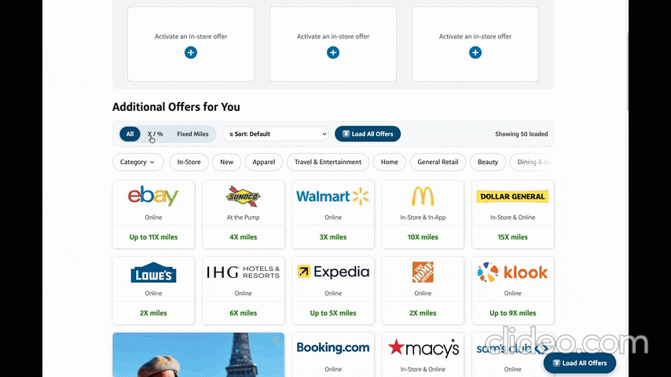

# YAC1Sorter (Yet Another C1 Offer Sorter)

An unofficial, lightweight Firefox extension that adds filtering, sorting, and infinite auto-loading to **Capital One Offers** (`capitaloneoffers.com`).

> **Disclaimer:** This project is an independent, unofficial browser extension and is not affiliated with, endorsed by, or sponsored by Capital One.

## Features

* **Segmented Offer Filter (`All` | `X / %` | `Fixed Miles`):** Quickly isolate flat point/cashback offers (e.g., `22,500 miles`) from multiplier offers (e.g., `30X miles`).
* **Smart Sorting Dropdown:**
  * `Fixed 1st → Highest X`
  * `Highest X 1st → Fixed`
  * `High → Low` / `Low → High`
* **Carousel Unpacking & Deduplication:** Automatically surfaces high-value offers hidden inside horizontal carousels into the main grid and removes duplicate merchant tiles.
* **Auto-Load All Offers (`⏬ Load All Offers`):** Automatically clicks *"View More Offers"* until your entire offer feed is loaded on a single page.
* **100% Local & Private:** Collects zero user data, makes no external network requests, and runs strictly on `capitaloneoffers.com`.

## Installation

* Download this repository - https://github.com/sahithiindarapu/yac1sorter/archive/refs/tags/2026.10.14.zip

### Firefox

* Open Firefox and navigate to `about:debugging#/runtime/this-firefox` (enter this in navigation bar).
* Click `Load Temporary Add-on...` and select the `manifest.json` file from `firefox` folder.

### Google Chrome

* Open Chrome and navigate to `chrome://extensions/` (enter this in navigation bar).
* Enable **Developer mode** using the toggle in the top-right corner.
* Click **Load unpacked** in the top-left corner and select `chrome` folder.

And then visit https://capitaloneoffers.com and log in.
